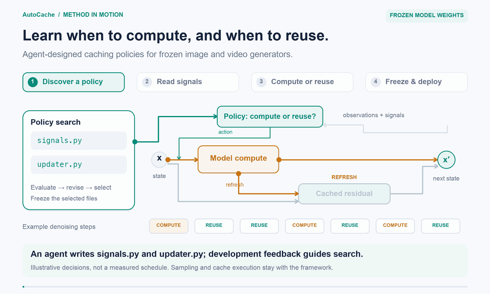

# AutoCache: Agent-Designed Caching for Image and Video Generation

<a id="authors"></a>

**👥 Authors:** [Canyu Shen](https://github.com/shuiiiiyu)<sup>1</sup> · [Yang Chen](https://github.com/cheyan9)<sup>2</sup> · [Gezhi Zhu](https://github.com/TetuDegit)<sup>2</sup> · [Xuemei Zhou](https://www.cwi.nl/en/people/xuemei-zhou/)<sup>3</sup> · [Teng Long](https://tenglon.github.io/)<sup>4</sup> · [Vincent Tao Hu](https://taohu.me/)<sup>2</sup>

<sup>1</sup> Tongji University<br>
<sup>2</sup> Huazhong University of Science and Technology<br>
<sup>3</sup> Centrum voor Wiskunde en Informatica (CWI)<br>
<sup>4</sup> University of Trento

[🌐 Project website](https://vibe-hust.github.io/autocache_page/) · [💻 Code repository](https://github.com/vibe-hust/autocache_code)

AutoCache uses an agent to discover executable caching policies for frozen image
and video generators. This repository contains the search controllers, model
adapters, baseline implementations, evaluation code, prompt/seed manifests, and
frozen policies from the prepared paper code release.


<a id="method-in-motion"></a>

## 🎬 Method in motion



Policy search and runtime cache decisions, shown schematically. The displayed decisions are illustrative.

[Static overview](docs/assets/method-overview.png) · [Animation source and notes](docs/method-animation.md)

<a id="setup-and-cpu-configuration-checks"></a>

## 🛠️ Setup and CPU configuration checks

Use Python 3.10 or newer and run commands from the repository root:

```bash
git clone https://github.com/vibe-hust/autocache_code.git
cd autocache_code
python -m venv .venv
source .venv/bin/activate
python -m pip install -e .

python -m variants.opal_search.search check experiments/qwen21-drawbench30-170/search.json
python -m variants.opal_search.search check experiments/flux3-drawbench30-170/search.json
python -m variants.wan21_opal.search check experiments/wan21-vbench124-820/search.json
```

The `check` commands validate configurations without generating samples or
calling the agent. Installing this package does not install the full GPU model
stack. Generation additionally needs the dependencies for the chosen backbone,
its model weights, and the metric checkpoints listed in the generation config.
See the bundled baseline requirements and [metric setup](metrics/README.md).

<a id="components"></a>

## 🗂️ Components

| Folder | Contents |
| --- | --- |
| `variants/opal_search/` | Qwen-Image-2.1 and FLUX3-Image-Klein-Base policy search |
| `variants/wan21_opal/` | Wan2.1-T2V-1.3B policy search |
| `reactive_samplers/` | Model adapters, observations, tracing, and evaluation |
| `experiments/` | Search settings and fixed prompt/seed manifests |
| `policies/` | Frozen `signals.py` and `updater.py` policy pairs |
| `baselines/` | Baseline implementations and retained upstream sources |
| `metrics/` | Metric support code and bundled CLIP source |
| `scripts/` | Latency and operator-count measurement utilities |
| `site/trento/` | Optional Slurm submission and remote agent relay tools |

<a id="search-and-evaluation"></a>

## 📊 Search and evaluation

The image and video controllers expose `check`, `run`, and `test`. Read the
[image search guide](variants/opal_search/README.md) or
[video search guide](variants/wan21_opal/README.md) before a GPU run. Configure
model and metric paths in the corresponding `generation.json` files. Preserve
the supplied prompt splits, seeds, and sampling settings for paper comparisons.

The supplied paper search configurations select the optional remote agent
relay through `agent.command`. That relay requires an operator-configured SSH
host, CLI installation, and existing authentication. For a local agent, remove
`agent.command` to use the built-in `agent_cli.py`, and configure `agent.model`,
`agent.profile`, and `agent.reasoning_effort` for your own installation. The
relay worker's options are documented by `site/trento/bridge_worker.py --help`.
Credentials and authentication state are not included in this repository.

Frozen policies can be inspected in `policies/`; new searches and evaluations
write separate run directories. Model checkpoints and generated outputs must
be downloaded or produced separately.

<a id="acknowledgments"></a>

## 🙏 Acknowledgments

We thank the authors and maintainers of the models, caching baselines, and evaluation tools used in this release:

- **Model families:** [Qwen-Image](https://github.com/QwenLM/Qwen-Image), [FLUX by Black Forest Labs](https://huggingface.co/black-forest-labs), and [Wan2.1](https://github.com/Wan-Video/Wan2.1).
- **Caching baselines:** [TeaCache](https://github.com/LiewFeng/TeaCache), [DPCache](baselines/DPCache), [BudCache](baselines/BudCache), and the DiCache, SeaCache, MagCache, and other comparisons described in the [baseline inventory](baselines/README.md).
- **Evaluation tools:** [OpenAI CLIP](https://github.com/openai/CLIP), [ImageReward](https://github.com/zai-org/ImageReward), and [LPIPS](https://github.com/richzhang/PerceptualSimilarity).
- **Runtime libraries:** [PyTorch](https://github.com/pytorch/pytorch) and [Diffusers](https://github.com/huggingface/diffusers).

Retained upstream sources keep their original copyright notices and licenses. See the [metric setup](metrics/README.md) for evaluation dependencies.

<a id="citation"></a>

## 📚 Citation

If you use this work or code, please cite:

```bibtex
@misc{shen2026autocache,
  title  = {{AutoCache: Agent-Designed Caching for Image and Video Generation}},
  author = {Shen, Canyu and Chen, Yang and Zhu, Gezhi and Zhou, Xuemei and Long, Teng and Hu, Vincent Tao},
  year   = {2026},
  url    = {https://github.com/vibe-hust/autocache_code}
}
```

A machine-readable citation is available in [CITATION.cff](CITATION.cff).

<a id="license"></a>

## 📄 License

AutoCache's original code is released under the [MIT License](LICENSE).

Bundled third-party code retains its own terms, including [TeaCache](baselines/TeaCache/LICENSE), [DPCache](baselines/DPCache/LICENSE), [BudCache](baselines/BudCache/LICENSE), [Wan2.1](baselines/Wan2.1/LICENSE.txt), and [OpenAI CLIP](metrics/clip/source/LICENSE). Model checkpoints and external evaluation assets are covered by their respective upstream licenses.
